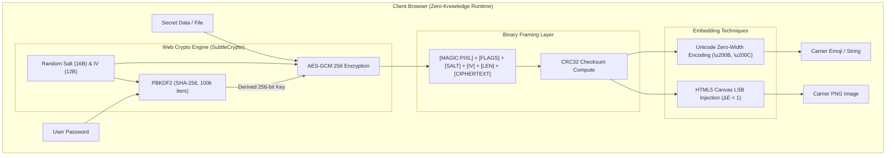

# PixelLock 🔒
> **Zero-Knowledge Client-Side Steganography & Applied Cryptography Suite.** Conceal encrypted binary files, text, and audio payloads inside ordinary image pixels and Unicode emoji sequences.

<div align="center">

  [](https://pixel-lock.vercel.app)
  [](https://developer.mozilla.org/en-US/docs/Web/API/Web_Crypto_API)
  [](https://pixel-lock.vercel.app)
  [](https://www.typescriptlang.org/)

</div>

---

## 1. Overview
**PixelLock** is an open-source, privacy-first steganographic security tool operating entirely within the user's browser. It allows users to embed encrypted data—such as passwords, confidential documents, keys, or private communications—directly inside ordinary PNG/BMP images or invisible Unicode emoji sequences. By coupling military-grade AES-GCM 256-bit encryption with Least Significant Bit (LSB) pixel alteration and zero-width characters, PixelLock provides both cryptographic confidentiality and steganographic deniability without transmitting a single byte to any remote server.

- **Production Tool**: [https://pixel-lock.vercel.app](https://pixel-lock.vercel.app)
- **Primary Domain**: Applied Cryptography & Information Security

---

## 2. Problem
In modern digital communications, encryption alone is frequently insufficient:
1. **Metadata & Surveillance Flags**: Encrypted payloads (PGP messages, `.gpg` attachments, password-protected `.zip` files) draw immediate scrutiny from automated network deep-packet inspection (DPI) and platform scrapers.
2. **Third-Party Key Escrow Risks**: Traditional cloud encryption tools frequently process data on external servers, exposing keys to server compromises, subpoenas, and memory inspection.
3. **Tampering & Payload Corruption**: Basic steganography tools lack cryptographic authentication; corrupted bits during transfer produce garbage output without alerting the user of tampering.

**PixelLock solves this** by executing end-to-end encryption in volatile browser memory before embedding, wrapping data in a custom CRC32-validated binary frame, and rendering payloads completely invisible to both casual observers and perceptual inspection.

---

## 3. Features

### 🔐 Authenticated In-Browser Cryptography
- **SubtleCrypto Native**: Utilizes the browser's hardware-accelerated `window.crypto.subtle` API.
- **Key Derivation (PBKDF2)**: Derives 256-bit keys from human passwords using PBKDF2 with SHA-256 and a 16-byte cryptographically secure pseudorandom salt.
- **AES-GCM 256-bit**: Provides authenticated encryption with associated data (AEAD), guaranteeing confidentiality and ciphertext authenticity with a 12-byte initialization vector (IV).

### 🖼️ High-Fidelity LSB Canvas Steganography
- Embeds bits sequentially across the red, green, and blue channels of an HTML5 Canvas pixel buffer.
- Color channel modifications stay well below human perceptual thresholds ($\Delta E < 1$), preserving image appearance without visible artifacts.

### 🔤 Unicode Zero-Width Steganography
- Encodes binary bitstreams into alternating sequences of invisible Unicode characters:
  - `\u200B` (Zero-Width Space) $\rightarrow$ Bit `0`
  - `\u200C` (Zero-Width Non-Joiner) $\rightarrow$ Bit `1`
- Seamlessly hides secret messages inside innocent tweets, chat messages, or single emojis.

### 📦 Custom Binary Framing & Integrity Verification
```text
+----------------+------------+---------------+--------------+---------------------+-------------------+---------------+
| MAGIC (4B)     | FLAGS (1B) | SALT (16B)    | IV (12B)     | PAYLOAD LENGTH (4B) | ENCRYPTED PAYLOAD | CRC32 (4B)    |
| 'P' 'I' 'X' 'L'| Compression| PBKDF2 Salt   | GCM IV       | Uint32 Big-Endian   | Ciphertext Bytes  | Checksum Tag  |
+----------------+------------+---------------+--------------+---------------------+-------------------+---------------+
```
- **Integrity Validation**: A 4-byte CRC32 checksum confirms payload integrity prior to decryption, immediately identifying incorrect passwords or corrupted images.

---

## 4. Live Demonstrations

| Feature Flow | Method | Live Access |
| :--- | :--- | :--- |
| **Image Steganography** | LSB Canvas 24-bit embedding with AES-GCM | [Launch Image Stego](https://pixel-lock.vercel.app) |
| **Emoji Secret Messages** | Zero-width character hiding inside Unicode emojis | [Launch Emoji Stego](https://pixel-lock.vercel.app) |
| **Extraction & Decrypt** | Automated frame detection, CRC32 check & unlock | [Launch Extractor](https://pixel-lock.vercel.app) |

---

## 5. Architecture



---

## 6. Tech Stack

| Component | Technology | Implementation Details |
| :--- | :--- | :--- |
| **Core Cryptography** | Web Crypto API (`window.crypto.subtle`) | AES-GCM (256-bit), PBKDF2 (SHA-256) |
| **Data Framing** | JavaScript TypedArrays | `Uint8Array`, `DataView`, IEEE CRC32 |
| **Steganography Engine** | HTML5 Canvas 2D API | `getImageData()`, `putImageData()` bitwise masks |
| **Framework & UI** | React 18, TypeScript 5.2, Tailwind CSS | Modular components with dark aesthetic |
| **Build Tooling** | Vite 5.2 | Fast HMR and optimized production bundles |
| **Deployment** | Vercel | Edge CDN static asset delivery |

---

## 7. Installation & Local Development

### Prerequisites
- **Node.js**: v18.0.0 or higher
- **npm** or **yarn**

### Steps

1. **Clone the repository**:
   ```bash
   git clone https://github.com/rajdeepbhattacharyya25-pixel/pixel-lock.git
   cd pixel-lock
   ```

2. **Install project dependencies**:
   ```bash
   npm install
   ```

3. **Start local development server**:
   ```bash
   npm run dev
   ```

4. **Build production distribution**:
   ```bash
   npm run build
   ```

---

## 8. Testing & Verification

PixelLock is verified across multiple browser engines for cryptographic correctness and mathematical imperceptibility.

### Test Scenarios
- **Roundtrip Encryption/Decryption**: Binary file input matches decrypted output byte-for-byte (`hash(input) === hash(output)`).
- **CRC32 Checksum Validation**: Intentionally flipped bits in the carrier image trigger an immediate `ChecksumMismatchException` before decryption.
- **Wrong Password Handling**: Throws an authentication failure without crashing or leaking memory.
- **Perceptual Delta ($\Delta E$)**: RGB channel variation measured below 1.0 on standard CIE76 color difference formulas.

---

## 9. Roadmap
- [ ] **Spread Spectrum Steganography (DWT)**: Discrete Wavelet Transform embedding for resistance against lossy JPEG re-compression.
- [ ] **WAV Audio Carrier**: Least Significant Bit encoding in uncompressed 16-bit PCM audio waveforms.
- [ ] **Hardware Security Key Support**: WebAuthn/FIDO2 token authentication for passwordless key derivation.
- [ ] **Deniable Multi-Payload Containers**: Secondary hidden payloads revealed under distinct duress passwords.

---

## 10. Credits & References
- [W3C Web Cryptography API Specification](https://www.w3.org/TR/WebCryptoAPI/)
- [Lucide Icons](https://lucide.dev/) for clean technical UI iconography
- Built and maintained by [Rajdeep Bhattacharyya](https://github.com/rajdeepbhattacharyya25-pixel).
